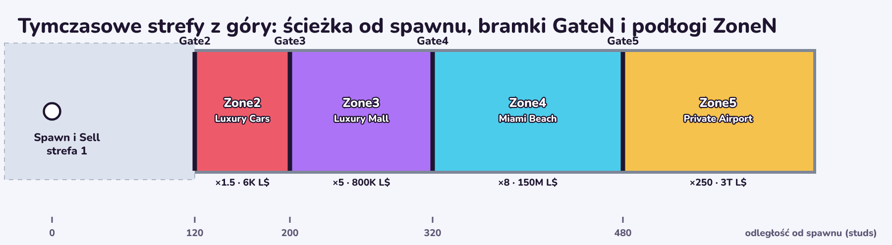

# Larp in Miami

Kod gry Roblox „Larp in Miami”. Kod jest w plikach (Luau), a Rojo przenosi go do Roblox Studio.

```
GitHub (kod)  ──git pull──▶  Twój komputer (ten folder)  ──rojo serve──▶  Roblox Studio
   ▲                                                                    (Plugins → Rojo → Connect)
   └── Claude wrzuca tu nowy kod
```

Mapę, modele i wygląd UI budujesz w Studio. Skrypty edytujemy tylko w plikach, bo Rojo nadpisuje je w Studio.

## Co jest w środku

| Folder | Trafia w Studio do | Co zawiera |
| --- | --- | --- |
| `src/shared` | ReplicatedStorage → Shared | `Config/Economy` (liczby z arkusza, generowane), `Config/Settings` (ustawienia gry, edytowane ręcznie), `Config/Pets` (nazwy i kolory petów), `Config/Clothes` (nazwy, kolory i kształty ubrań i boxów), `Config/Interview` (pytania i odpowiedzi w wywiadzie, edytowane ręcznie), `Config/RobuxIds` (ID gamepassów i produktów z Creator Hub, edytowane ręcznie), `Data/Template` (szablon zapisu gracza), `Logic/Loop` (klik, Bag, Sell, ulepszenia, strefy, aktywności, pety), `Logic/Clothes` (ubrania: boxy, sloty, bonus do LP, sprzedaż, łączenie), `Logic/Rebirth` (Rebirth, Aura, pasek Aury, sklep Aury), `Logic/Shop` (zakupy za Robuxy: premium jajka, boosty, Starter Pack, reklamy, numery zakupów), `Logic/Interview` (losowanie pytań i sprawdzanie treści wywiadu), `Logic/RateLimiter`, `Formulas`, `Format`, `Net` (zdarzenia sieciowe), `Robux` (ID i ceny gamepassów i produktów), `ClothModels` (ubrania z klocków na postaci i w okienkach, pudełka boxów), `Tests` |
| `src/server` | ServerScriptService → Server | `Main` (start serwera), `ConfigCheck` (testy w Studio), `Services/` (DataService, GamepassService, ZoneService, LoopService, ActivityService (aktywności w strefach 2–5), PetService, ClothesService (boxy i ubrania), RebirthService (Rebirth i sklep Aury), ShopService (zakupy za Robuxy, reklamy, teleport), AdminService), `Vendor/ProfileStore` (zapis danych) |
| `src/client` | StarterPlayerScripts → Client | `Main` (start gracza), `Hud` (interfejs), `Zones` (bramki, tablice, okno Unlock), `Activities` (aktywności: auto, wywiad, jacht, odrzutowiec), `InterviewShow` (program wywiadu: pytania, odpowiedzi, czat), `Pets` (okno PETS: sprzedaż, łączenie, indeks; pety za graczami), `Wardrobe` (okno CLOTHES), `MergeWindow` (okno i animacja łączenia petów i ubrań), `Eggs` (jajka: tablice, okno, otwieranie), `Boxes` (mystery boxy: tablice, okno, otwieranie), `SecretBanner` (komunikat o sekrecie u góry ekranu), `RebirthUi` (portal, okno i animacja Rebirth), `AuraShop` (sklep Aury), `Shop` (kafelki SHOP i TELEPORT, Starter Pack, boosty w rogu, ceny i zakup), `ShopWindow` (okno sklepu), `ShopThanks` (podziękowanie po zakupie), `ShopCatalog` (nazwy, opisy i grafiki produktów), `Nametags` (tytuł, znaczek Verified i Aura Level nad głową, poświata), `StandAnchor` (punkt zaczepienia napisów nad stoiskami), `PetModels` (modele petów i jajek, wersje Golden i Diamond), `LocalHide` (ukrywanie części tylko u gracza), `Ui/Theme` (kolory, czcionka, skala), `Ui/Kit` (przyciski, kafelki, okna), `Ui/Icons` (ikony), `Ui/Sounds` (dźwięki), `Ui/Pattern` (wzór w tle), `Ui/Fx` (animacje i efekty: połysk, promienie, iskry, konfetti), `Ui/ShopArt` (grafiki gamepassów z obrazków), `ClickInput` (klikanie), `State` (stan od serwera), `Admin` (komendy testowe) |
| `assets/icons` | — | `larp-icons.png` (arkusz 16 ikon do wgrania w Roblox) i `svg/` (źródła ikon) |
| `docs` | — | rysunki do tego opisu (np. układ tymczasowych stref) |
| `tools` | — | `gen_config.py` (tworzy Config z modelu ekonomii), `test_luau.py` (testy bez Roblox), `build_icons.py` (rysuje arkusz ikon), `economy/` (model i symulacja) |
| `licenses` | — | licencje bibliotek (ProfileStore: Apache 2.0) |

## Instalacja (raz, Windows)

Wszystkie komendy wpisujesz w PowerShell.

1. **Git:** pobierz z https://git-scm.com/download/win i zainstaluj z domyślnymi opcjami.
2. **Rokit** (instaluje narzędzia Roblox):
   ```powershell
   Invoke-RestMethod https://raw.githubusercontent.com/rojo-rbx/rokit/main/scripts/install.ps1 | Invoke-Expression
   ```
   Potem zamknij PowerShell i otwórz go ponownie.
3. **Projekt:** pobierz go do folderu Dokumenty:
   ```powershell
   cd $HOME\Documents
   git clone https://github.com/TheFalconPlr/larp-in-miami.git
   cd larp-in-miami
   ```
4. **Rojo i plugin do Studio.** Wersja Rojo jest już zapisana w `rokit.toml`, więc wystarczą dwie komendy:
   ```powershell
   rokit install
   rojo plugin install
   ```
   Jeśli Rokit zapyta, czy ufasz narzędziu, odpowiedz `y`. Po instalacji pluginu uruchom Studio ponownie.
   Jeśli `rojo` zgłasza „Aftman error”, masz starsze narzędzie Aftman: zmień nazwę folderu `$HOME\.aftman` (np. na `.aftman-stary`) i otwórz PowerShell od nowa.
5. Opcjonalnie: VS Code z rozszerzeniami **Rojo** i **Luau Language Server**, jeśli chcesz zaglądać w kod.

## Codzienna praca (krok po kroku)

Za każdym razem, gdy włączasz laptopa i chcesz popracować:

```
PowerShell:  cd do projektu  →  git pull  →  rojo serve (to okno zostaje otwarte)
Studio:      otwórz grę  →  Plugins → Rojo → Connect  →  Play (F5)
Koniec:      Stop  →  Ctrl+S  →  w oknie z Rojo Ctrl+C
```

1. **Otwórz PowerShell:** Start → wpisz `PowerShell` → Enter.
2. **Wejdź do folderu projektu:**
   ```powershell
   cd $HOME\Documents\larp-in-miami
   ```
3. **Pobierz nowy kod od Claude:**
   ```powershell
   git pull
   ```
   Dobrze, gdy widzisz listę zmienionych plików albo `Already up to date.` (nic nowego).
4. **Uruchom Rojo:**
   ```powershell
   rojo serve
   ```
   Dobrze, gdy widzisz `Rojo server listening` i `Port: 34872`. Nie zamykaj tego okna, dopóki pracujesz: bez niego Studio nie dostaje kodu.
5. **Otwórz Roblox Studio** i grę `[NEW] Larp in Miami!` (z ostatnich gier albo z grupy Larping Studio$).
6. **Połącz Studio z Rojo:** zakładka **Plugins** → **Rojo** → **Connect**. Po chwili plugin pokazuje „Connected”, a skrypty z plików są już w Studio.
7. **Testuj:** **Play** (F5). W oknie **Output** (View → Output) powinny być m.in. te linie:
   ```
   [Larp in Miami] Serwer działa. Ekonomia v2 (arkusz z 29.10.2026). Strefa 5 kosztuje 3T L$, Rebirth 10 kosztuje 750Qa L$.
   ConfigCheck: OK (64 testów zgodnych z arkuszem)
   LoopCheck: OK (103 testów pętli: klik, Bag, Sell, ulepszenia, strefy, aktywności, pety)
   InterviewCheck: OK (16 testów wywiadu: pytania, odpowiedzi, losowanie)
   [Dane] TwojNick: zapis wczytany (DataStore: Access)
   ```
   Komendy testowe wpisujesz na czacie (zacznij od `/cmds`). **Stop** (Shift+F5) kończy test.
8. **Zapisz grę:** Ctrl+S (File → Save to Roblox). Gdy gracze mają zobaczyć zmiany: File → Publish to Roblox (Alt+P).
9. **Koniec pracy:** kliknij okno PowerShell z Rojo i naciśnij **Ctrl+C** (Rojo się zatrzymuje), potem zamknij Studio.

**Nowy kod w trakcie pracy.** Nie trzeba niczego wyłączać: otwórz drugie okno PowerShell i wpisz `cd $HOME\Documents\larp-in-miami`, a potem `git pull`. Rojo sam przeniesie zmiany do Studio, a Ty zrób Stop i Play.

**Gdy coś nie działa:**

| Problem | Co zrobić |
| --- | --- |
| `git pull` pisze `Your local changes ... would be overwritten` | W folderze ktoś zmienił pliki. `git stash` odkłada te zmiany na bok, potem znowu `git pull`. |
| `rojo` „is not recognized” | `rokit install`, potem zamknij PowerShell i otwórz go od nowa. |
| `rojo serve` pisze, że port jest zajęty | Rojo już działa w innym oknie PowerShell. Użyj tamtego albo je zamknij i uruchom `rojo serve` jeszcze raz. |
| Plugin Rojo się nie łączy | Sprawdź, czy okno z `rojo serve` jest otwarte, i kliknij Connect jeszcze raz (adres `localhost`, port `34872`). |
| W Studio jest stary kod | W pluginie Rojo: Disconnect, potem Connect. Potem Stop i Play. |
| W Output są czerwone błędy | Zrób zrzut ekranu okna Output i wyślij go Claude. |

## Etap 2: rdzeń pętli

Co działa: klikanie (myszą albo krótkim dotknięciem ekranu), LP trafiają do Bag, pole Sell zamienia LP na L$, przycisk SELL przenosi na pole Sell, ulepszenia Click Multiplier i Bag (Kup 1 i Kup max), zapis postępu, leaderstats (L$, Rebirthy i Aura w tabeli graczy pod Tab), podpowiedzi dla nowego gracza i tryb testowy.

**Sprzedaż.** Przy każdej sprzedaży banknoty wyskakują z paska Bag i lecą łukiem do licznika L$ (przy Auto-Sell mniej banknotów).

**Pole Sell.** Jeśli na mapie nie ma pola Sell, serwer stawia tymczasowe zielone pole obok spawnu. Gdy zbudujesz prawdziwe, nazwij część (Part) podłogi pola `SellPad` albo dodaj jej tag `SellPad` (Properties → Tags). Wtedy tymczasowe pole przestanie się pojawiać.

**Zapis danych.** Studio z włączonym „Enable Studio Access to API Services” zapisuje do prawdziwego DataStore tej gry. Dopóki gra nie jest publiczna, to nic złego, a test „wyjdź i wróć” działa w Studio: Stop, potem znowu Play. Jeśli w Output jest `DataStore: NoAccess`, włącz ten przełącznik (File → Experience Settings → Security).

**Ustawienia** (limit kliknięć, nazwa DataStore, admini) są w `src/shared/Config/Settings.luau`.

## Etap 3: strefy

Co działa: 5 stref z arkusza. Downtown Miami jest za darmo, a kolejne kupujesz za L$: Luxury Cars (6K), Luxury Mall (800K), Miami Beach (150M) i Private Airport (3T). Kupuje się je po kolei, przy bramce: gdy podejdziesz, otworzy się okno „Unlock” z ceną i mnożnikiem. Bramka znika tylko u gracza, który kupił strefę, a inni dalej widzą ścianę. W kupionej strefie każdy klik daje więcej LP (×1,5, ×5, ×8 i ×250), a po wejściu do strefy u góry ekranu pojawia się jej nazwa. Nad zamkniętymi bramkami wiszą tablice z nazwą, mnożnikiem i ceną.

**Tymczasowe strefy.** Dopóki na mapie nie ma stref, serwer stawia kolorową ścieżkę przed spawnem, w stronę, w którą patrzy SpawnLocation. Są na niej strefy 2–5 z bramkami i ścianami po bokach. Odległości są z arkusza: środek strefy jest tak daleko od spawnu, ile trwa powrót z niej na Sell (np. strefa 5: 35 s × 16 studs/s = 560 studs).



**Twoje strefy.** Gdy budujesz prawdziwą mapę, nazwij części tak:

| Co | Nazwa | Uwagi |
| --- | --- | --- |
| Strefa 2–5 | `Zone2` … `Zone5` | Część (podłoga strefy albo niewidzialne pudło) albo model/folder z całą strefą. Do strefy liczy się wszystko nad jej częściami, do 60 studs w górę. Poza strefami 2–5 jest strefa 1 (spawn i Sell). |
| Bramka | `Gate2` … `Gate5` | Część albo model, który zamyka przejście do strefy. Ścieżka powinna mieć ściany po bokach, żeby bramki nie dało się obejść (mnożnik i tak działa tylko w kupionej strefie). |

Gdy na mapie jest choć jedna część `ZoneN`, tymczasowe strefy już się nie pojawiają. Jeśli którejś strefy albo bramki brakuje, w Output będzie ostrzeżenie `[Strefy]`.

## Etap 4: sesja zdjęciowa z autem

Co działa: w Luxury Cars stoi auto do zdjęć. Gdy podejdziesz, otworzy się okno „Car Photoshoot” z autem, nagrodą i przyciskiem START. Sesja trwa jak w arkuszu (8 s plus 3 s przejścia): ekran się ściemnia, stajesz przy aucie, kamera krąży wokół, błyskają flesze, a inni gracze są u Ciebie ukryci. W tym czasie kliknięcia nie działają. Na koniec LP trafiają do Bag, ale tylko tyle, ile się zmieści (z Auto-Sell całość). Gdy nagroda jest większa niż wolne miejsce, okno pokazuje „(Bag limit)”, więc opłaca się większy Bag. Z pełnym Bag sesji się nie zaczyna (najpierw Sell). Nagroda = wartość kliku × 110 × mnożnik auta × bonusy LP, bez mnożnika strefy. W tym samym oknie kupujesz lepsze auta za L$: German Sedan (20K, ×1,5), Muscle Car (50K, ×2,5), Italian Supercar (100K, ×4) i Hypercar (200K, ×6). Nazwy aut są robocze, zmienisz je w `src/client/Activities.luau` (`CarNames`).

**Tymczasowe miejsce.** Dopóki na mapie nie ma `CarSpot`, serwer stawia w strefie 2 platformę z 5 prostymi autami z klocków. Każdy gracz widzi tylko auto ze swojego tieru.

**Twoje miejsce.** Model `CarSpot` w strefie 2, a w nim:

| Co | Nazwa | Uwagi |
| --- | --- | --- |
| Auta | `Car1` … `Car5` | Po jednym modelu na tier, wszystkie w tym samym miejscu. Gracz widzi tylko swoje. |
| Miejsce gracza | `Pose` | Niewidoczna część na podłodze. Gracz stoi na pierwszej widocznej powierzchni pod jej czubkiem (więc Pose może trochę wystawać nad podłogę albo pokład), przodem tam, gdzie patrzy przód części. Wysokość liczy się z awatara (R15 i R6, niski i wysoki), więc nikt nie wisi w powietrzu. |
| Reszta | dowolne | np. platforma, światła, dekoracje |

Kamera krąży wokół punktu obrotu (pivot) modelu `CarSpot`, więc ustaw go na środku auta. Dźwięki sesji są w `Settings.Sounds`: `Photo` (migawka przy fleszu) i `Reward` (oklaski na koniec).

## Etap 5: jajka i pety

Co działa: w każdej strefie stoją dwa jajka za L$: zwykłe i złote (droższe, z lepszymi szansami). Przy każdym jajku jest żółta pigułka z ceną. Jak w Pet Simulator 99: gdy podejdziesz, nad jajkiem pojawia się biały panel z petami, które mogą wypaść, i ich szansami, a przed jajkiem duże E. Sekretny pet jest na panelu złotego jajka czarną sylwetką na szarym kafelku, jak nieodkryty w INDEX. Klawisz E (albo kliknięcie w E, na telefonie dotknięcie) otwiera okno kupna „Would you like to buy a … Egg?” z Buy 1 i Buy 3. Buy 3 otwiera trzy jajka naraz i działa z gamepassem Triple Open (w teście `/pass TripleOpen`).

Animacja otwierania: jajko pęka 3 razy (dźwięk coraz wyżej, rysy i odpryski), skorupka się rozpryskuje, a pet wkręca się i odbija na tle promieni i poświaty w kolorze rzadkości. Przy Legendary i Secret są jeszcze iskry, drżenie ekranu i oklaski. Napisy (nazwa, rzadkość z bonusem, „Equipped!”) wskakują po kolei, a na koniec pet leci do kafelka PETS. W czasie animacji HUD jest schowany. Pierwsze jajko w grze (zwykłe w Downtown Miami) zawsze daje Rare. Nowy pet sam się zakłada, jeśli jest wolne miejsce.

Założone pety latają za graczem (widzą je wszyscy) i zwiększają L$ przy Sell. Bonus peta = moc strefy × mnożnik rzadkości, np. Rare z Downtown Miami daje +20% L$, a dwa takie pety dają ×1,4. Miejsca na pety: 3, po jednym więcej od Rebirth 3 i Rebirth 7, a gamepass Pet Slots daje +2. Kafelek PETS po lewej otwiera ekwipunek: kliknij peta, żeby go założyć albo zdjąć, a EQUIP BEST zakłada najmocniejsze. Obok tytułu widać, ile masz petów (np. 37/250; ekwipunek mieści 250). Czerwona kropka na PETS znaczy, że masz wolne miejsce i peta do założenia. Sprzedaż, łączenie i indeks petów opisuje Etap 7.

| Strefa | Zwykłe jajko | Złote jajko | Common → Legendary |
| --- | --- | --- | --- |
| Downtown Miami | 400 L$ | 2K L$ | +5% → +80% L$ |
| Luxury Cars | 6K L$ | 40K L$ | +12% → +192% L$ |
| Luxury Mall | 1M L$ | 5M L$ | +30% → +480% L$ |
| Miami Beach | 60M L$ | 400M L$ | +75% → +1200% L$ |
| Private Airport | 30B L$ | 200B L$ | +200% → +3200% L$ |

Zwykłe jajko: Common 60%, Uncommon 28%, Rare 10%, Epic 2%. Złote: Uncommon 50%, Rare 35%, Epic 13%, Legendary 2% i Secret 0,004% (×64). Ulepszenie Luck za Aurę (Etap 9) zwiększa szanse na rzadsze pety. Premium jajko za Robuxy (Etap 10): Epic 75%, Legendary 22%, Mythic 3%, a na nie Luck nie działa.

**Tymczasowe stoiska.** Dopóki na mapie nie ma żadnego stoiska, serwer stawia je sam: w Downtown Miami z boku drogi od spawnu do bramki, a w strefach 2–5 na podłodze strefy.

**Twoje stoiska i pety.**

| Co | Nazwa | Uwagi |
| --- | --- | --- |
| Zwykłe jajko | `EggA1` … `EggA5` | Model albo część; cyfra to strefa. Panel z petami wisi nad najwyższym punktem stoiska, a pigułka z ceną przy jego spodzie. Panel i E pokazują się, gdy gracz stoi najwyżej 8 studs od stoiska. |
| Złote jajko | `EggB1` … `EggB5` | jak wyżej |
| Model peta | folder `PetModels` w ReplicatedStorage, a w nim modele nazwane jak pety (np. `Pigeon`, `Alley Cat`) | Wielkość ok. 2–3 studs. Pet patrzy tam, gdzie przód punktu obrotu (pivot) modelu. Bez modelu pet jest kolorową kulką z oczami w kolorze rzadkości. Nazwy wszystkich petów są w `src/shared/Config/Pets.luau`. |

Dźwięki są w `Settings.Sounds`: `Crack` (pojedyncze pęknięcie: gra 3 razy, coraz wyżej), `Hatch` (nowy pet: gra, gdy skorupka pęka i widać peta; pęknięcia przy pokazanym pecie już nie ma) i `Reward` (oklaski przy Legendary, Mythic i Secret).

## Etap 6: aktywności w strefach 3–5

Co działa: w każdej kupionej strefie jest jedna aktywność. Działa jak zdjęcia z autem: podchodzisz, otwiera się okno z nagrodą i przyciskiem START, a sesja to zaciemnienie, kamera i efekty. W tym czasie kliknięcia nie działają, a inni gracze są u Ciebie ukryci. Na koniec LP trafiają do Bag, ale tylko do pełna (z Auto-Sell całość).

| Strefa | Aktywność | Czas | Nagroda | Co kupujesz |
| --- | --- | --- | --- | --- |
| Luxury Mall | Celebrity Interview: wywiad w studiu telewizyjnym | 45 s | wartość kliku × 3000 × ocena | nic, ocena jest losowa: Flop ×0,5 (20%), Solid ×1 (40%), Viral ×2 (30%), Mega viral ×4 (10%) |
| Miami Beach | Yacht Party: impreza na jachcie | 45 s | wartość kliku × 6000 × jacht | Motor Yacht 400M (×2), Large Yacht 1,5B (×5), Superyacht 4B (×10), Mega Yacht 8B (×25) |
| Private Airport | Private Jet: lot odrzutowcem | 60 s | wartość kliku × 315K × odrzutowiec | Light Jet 120B (×1, pierwszy trzeba kupić), Midsize Jet 1T (×2,5), Ultra Long Range 4T (×6) |

Wszystkie nagrody mnożą też bonusy LP (Rebirth, 2x LP), ale nie mnożnik strefy.

- **Wywiad:** odliczanie „LIVE IN 3, 2, 1”, a potem prowadzący zadaje proste pytania o giełdę (np. „How many companies are in the S&P 500?”, „Who's your broker?”), jak w filmikach z „traderami” z Miami. Gracz ma 3 odpowiedzi do wyboru i wszystkie są głupie („5.”, „California”, „Gary from the gym”). Napisy pojawiają się litera po literze i zostają chwilę na ekranie, a odpowiedzi wyskakują dopiero, gdy pytanie jest napisane. Na wybór jest ok. 6–7 s (w ostatnich 3 s tyka zegar). Gracz wybiera kliknięciem albo klawiszem 1–3, a gdy czas minie, mówi „Uhh...” i losową odpowiedź. Studio reaguje na 4 sposoby: dramatyczne zbliżenie na prowadzącego z „vine boom”, śmiech publiczności (3 wersje), niezręczna cisza ze świerszczami albo „bruh”. Przez cały program gra muzyka talk show (przy reakcjach na chwilę ciszej). Po prawej leci czat z komentarzami (zawsze nad przyciskami z odpowiedziami, także w małym oknie Studio; gdy miejsca jest mało, czat jest niższy), z rogu wylatują emoji, a licznik wyświetleń skacze po każdej odpowiedzi. Zwykle są 3 pytania, a przy szybkich odpowiedziach 4 i pożegnanie gracza („Not financial advice!” → „Clearly.”). Na koniec klip idzie do sieci („whoosh”), czat komentuje wynik i wyskakuje ocena, np. MEGA VIRAL! ×4 (przy FLOP smutna trąbka). Wywiad trwa 45 s (wcześniej 25 s, było za szybko), a nagroda wzrosła tak, że LP na minutę zostały takie same. Ocenę losuje serwer na starcie, więc odpowiedzi jej nie zmieniają: są dla zabawy (inaczej każdy klikałby „najlepszą” i zawsze miał Mega viral, a to rozwaliłoby ekonomię). Okno przy studiu pokazuje nagrodę od–do i szanse ocen.
- **Jacht:** stoisz na pokładzie swojego jachtu i tańczysz, gra muzyka, jacht lekko się kołysze (Ty razem z nim), migają kolorowe światła, spada konfetti, a co kilka sekund ktoś robi zdjęcie (flesz z migawką). Kamera co ok. 4 s zmienia ujęcie jak w teledysku: plan ogólny, Ty z bliska, nisko od wody przy dziobie, zza pleców w stronę lądu, z drona i jazda wzdłuż burty. Kamera stoi zawsze po stronie lądu (tam, skąd przyszedłeś), więc nie wylatuje poza mapę. Na sam koniec trąbka i wybuch konfetti, a po zaciemnieniu oklaski.
- **Odrzutowiec:** w kabinie „ding”, gra muzyka do lotu, silnik rozkręca się (od 30% do pełnej głośności), samolot rusza po pasie (seria zdjęć przy starcie), startuje i leci wśród chmur: pod spodem, po bokach i czasem na trasie, a wtedy ekran na chwilę bieleje jak w chmurze. W locie co kilka sekund jest zdjęcie. Leci lokalna kopia samolotu (tylko u Ciebie), bo przy StreamingEnabled Roblox usuwał prawdziwy, gdy odleciał daleko od postaci. Twoje pety lecą z Tobą (na pasie ich nie widać). Bez odrzutowca okno pokazuje BUY.

W czasie sesji tablice aktywności i pigułki z cenami jajek są schowane, żeby nie wchodziły w kadr.

**Pytania w wywiadzie** zmieniasz w `src/shared/Config/Interview.luau`: pytanie (`Ask`), 3 odpowiedzi (`Say`), reakcja prowadzącego (`Reply`), komentarz w czacie (`Comment`) i rodzaj reakcji studia (`React`: `Boom`, `Laugh`, `Crickets` albo `Bruh`). Tam są też powitania, zakończenia, komentarze i nicki w czacie. Limity długości są opisane na górze pliku, a `python tools/test_luau.py` (i InterviewCheck w Studio) sprawdza, czy wszystko się mieści.

**Tymczasowe miejsca.** Dopóki na mapie nie ma miejsc, serwer stawia je z klocków po lewej stronie ścieżki: studio z tłem, biurkiem, prowadzącym i kamerą (strefa 3), basen z pomostem i 5 jachtami (strefa 4) oraz pas startowy z 3 odrzutowcami (strefa 5).

**Twoje miejsca.**

| Co | Nazwa | Uwagi |
| --- | --- | --- |
| Studio | model `InterviewSpot` w strefie 3 | W środku część `Pose` (tu stoi gość). Punkt obrotu (pivot) modelu na środku sceny, przodem do widowni: według niego ustawiają się kamery. |
| Jachty | model `YachtSpot` w strefie 4, w nim `Yacht1` … `Yacht5` | Jachty w tym samym miejscu na wodzie; w każdym może być własna `Pose` na pokładzie. Bez niej gracz stoi na `Pose` miejsca (np. na pomoście). Gracz staje na widocznym pokładzie pod `Pose` (jachty z innych tierów się nie liczą), a w czasie sesji nie skacze i nie „spada”, więc nie wisi nad pokładem, nawet gdy pokład nie ma kolizji. |
| Odrzutowce | model `JetSpot` w strefie 5, w nim `Jet1` … `Jet3` i `Pose` | Punkt obrotu każdego odrzutowca przodem w stronę dziobu: w tę stronę samolot startuje, więc przed nim musi być pas. |
| Tablica | część `SignAnchor` (niewidoczna) w dowolnym miejscu | Tablica z nazwą i nagrodą wisi nad nią. Bez niej wisi nad największą częścią miejsca. |

Nazwy modeli w grze (auta, jachty, odrzutowce) są robocze, zmienisz je w `src/client/Activities.luau` (`KINDS`).

## Etap 7: sprzedaż, łączenie, indeks i sekrety

Zasady są z dokumentu projektu (etap „Pety, ubrania, sekrety”). Okno PETS ma teraz na dole trzy przyciski: INDEX, MERGE i SELL. DELETE zniknął, bo sprzedaż robi to samo i jeszcze daje L$.

- **SELL:** klikasz pety do sprzedaży (dostają czerwony X). Na kartach widać cenę, a na dole sumę. DUPES zaznacza duplikaty (z każdego rodzaju zostaje jeden: założony albo najstarszy; sekretów nie rusza), ALL zaznacza wszystkie niezałożone, SELL (N) sprzedaje, a CANCEL wraca. Pet daje 10% ceny jajka, z którego wypadł; Golden ×5, a Diamond ×25 (czyli tyle, ile pety, które na niego poszły). Założonych petów nie da się sprzedać, a sprzedaż sekreta trzeba potwierdzić w okienku.
- **MERGE:** wybierasz od 1 do 5 identycznych petów (ta sama strefa, rzadkość i poziom). Wybrane mają fioletowe numery, a pety, których nie da się dołożyć, są przygaszone. Każdy pet to 20% szansy (Merge Luck z Aury dodaje 1 pkt proc. na peta), więc 5 petów to 100%. AUTO dobiera identyczne pety do 5, a bez wyboru bierze rodzaj, którego masz najwięcej. Na dole widać szansę i opłatę. MERGE otwiera okno z petami, które możesz stracić, wynikiem, szansą, opłatą i ostrzeżeniem. Sukces daje wersję Golden (×2 mocy), a z Golden wersję Diamond (×4). Porażka zabiera wszystkie wrzucone pety. Opłata przepada zawsze: za każdego peta 1/5 ceny jajka przy Golden albo cała cena jajka przy Diamond, więc średnio Golden kosztuje zawsze 5 petów i cenę jajka. Animacja: pety krążą i zlatują się do środka, błysk, a potem nowy pet z promieniami i oklaskami (leci do PETS) albo szare odłamki i smutna trąbka. Pety z premium jajek (za Robuxy, Etap 10) łączą się tylko przy 100%.
- **INDEX:** 35 petów (5 stref × 7 rzadkości): wszystko z jajek za L$ i Mythic z premium jajek (Etap 10). Odkryte widać normalnie, a nieodkryte jako czarną sylwetkę z „???”. Na dole jest licznik sekretów (np. 1/5). Pet, którego jeszcze nie miałeś, ma w animacji jajka napis NEW!. Stare zapisy dostają w indeksie pety, które już mają.
- **Sekrety:** wypadają tylko ze złotego jajka (1 na 25 000). Mają specjalną animację: fioletowo-złote promienie, fioletowy błysk, „vine boom”, mocniejsze drżenie, napis SECRET PET! z „1 in 25,000” i dłuższy pokaz. Chwilę później u wszystkich graczy na wszystkich serwerach wjeżdża u góry pasek z głową awatara, np. „Nasdaq hatched a SECRET Iced Flamingo, 1 in 25,000” (u Ciebie „You hatched…”). Działa przez MessagingService. W Studio bez dostępu do API komunikat widać tylko na tym serwerze, a w Output jest wtedy ostrzeżenie.
- **Golden i Diamond** mają złoty i diamentowy kolor (kulka albo Twój model), na karcie wstążkę GOLDEN albo DIAMOND, a w nazwie słowo z przodu, np. „Golden Pigeon”. Pety za graczem też są złote i diamentowe. Żeby nie było „Golden Golden Doge”, zmieniłem 4 robocze nazwy: Golden Doge → Crypto Doge, Diamond Flamingo → Iced Flamingo, Golden Whale → Mega Whale, Diamond Griffin → Jetset Griffin. Jeśli masz już modele petów pod starymi nazwami, zmień im nazwy. We własnym modelu części, które mają zostać w swoim kolorze (np. oczy), oznacz atrybutem `KeepColor` (true).

Dźwięki w `Settings.Sounds`: `MergeFail` (nieudane łączenie, smutna trąbka), `SecretReveal` (sekret z jajka, „vine boom”) i `SecretAnnounce` (komunikat o sekrecie, gong z kabiny samolotu). Podmień je, jeśli znajdziesz lepsze.

Do testu: `/pet Rare 1 5` daje 5 Rare do łączenia, `/pet Epic 2 1 gold` daje Golden Epic, `/secret 3` daje sekreta ze strefy 3 i ogłasza go, `/mergeluck 5` ustawia Merge Luck, a `/clearindex` czyści indeks (znów są napisy NEW!).

Jeszcze nie ma: tytułu „Secret Society” za komplet 5 sekretów i rankingu „Sekrety”. Dojdą razem z tytułami i rankingami, a licznik sekretów już się zapisuje.

## Etap 8: ubrania

Zasady są z dokumentu projektu (etap „Pety, ubrania, sekrety”). Ubrania podbijają LP: za klik i w aktywnościach (pety podbijają L$).

- **Mystery boxy w Mall.** Wszystkie trzy stoją w Mall, ale Designer da się kupić dopiero po odblokowaniu plaży, a Iced po odblokowaniu lotniska (wtedy pigułka pokazuje kłódkę i nazwę strefy). Działa jak przy jajkach: pigułka z ceną, panel z szansami nad boxem (rzadkość i bonus do LP; Ultra Secret bez bonusu, jako czarna sylwetka na szarym kafelku, która co chwilę zmienia się w inne ubranie: łańcuch, okulary, czapka, zegarek, buty), duże E na boxie i okno kupna z Buy 1 i Buy 3 (jak okno jajka, z napisem „1 random item from 7 categories”; bonusu do LP w oknie nie ma, gracz dowiaduje się go po otwarciu). Buy 3 otwiera trzy boxy naraz z tym samym gamepassem Triple Open co przy jajkach (w teście `/pass TripleOpen`). Animacja: boxy drżą 3 razy, wieka odlatują, a ze środka wyskakują ubrania z promieniami w kolorze rzadkości i lecą do kafelka CLOTHES.

| Box | Cena | Kiedy | Szanse |
| --- | --- | --- | --- |
| Street Box | 2,5M L$ | po odblokowaniu Mall | Common 60%, Uncommon 28%, Rare 10%, Epic 2% |
| Designer Box | 200M L$ | po odblokowaniu plaży | Uncommon 50%, Rare 35%, Epic 13%, Legendary 2% |
| Iced Box | 80B L$ | po odblokowaniu lotniska | Rare 50%, Epic 35%, Legendary 13%, Mythic 2%, Ultra Secret 0,0004% (1 na 250 000) |

- **Ultra Secret** wypada tylko z Iced Boxa, 10 razy rzadziej niż sekretny pet ze złotego jajka (1 na 250 000 zamiast 1 na 25 000). To ubrania „chrome”: czarne ze srebrnymi i białymi krzyżami (czapka, okulary, srebrny łańcuch z krzyżem, zegarek, koszulka z długim rękawem, jeansy i buty, po jednym w każdej kategorii). Tylko styl, bez nazwy prawdziwej marki i bez logo, tak jak przy autach. Bonus +1280% LP (2 razy więcej niż Mythic). Animacja: czarno-srebrne promienie, srebrny błysk, „vine boom”, mocniejsze drżenie, napis ULTRA SECRET! z „1 in 250,000” i dłuższy pokaz. Potem u wszystkich graczy na wszystkich serwerach wjeżdża srebrny pasek, np. „Nasdaq unboxed an ULTRA SECRET Chrome Cross Tee, 1 in 250,000”. Sprzedaż Ultra Secret trzeba potwierdzić, a DUPES ich nie zaznacza.

- **7 kategorii po 1 slocie:** Hair, Glasses, Chain, Watch, Shirt, Pants, Shoes. Kategoria wypada losowo (każda tak samo często). Gamepassy Double Chain i Double Wrist dają drugi łańcuch i drugi zegarek (w teście `/pass DoubleChain`, `/pass DoubleWrist`). Bonus do LP: Common +20%, Uncommon +40%, Rare +80%, Epic +160%, Legendary +320%, Mythic +640%, a Golden ×2 i Diamond ×4. Bonusy założonych ubrań się dodają, np. Rare łańcuch i Epic włosy dają ×3,4 LP. Nowe ubranie samo się zakłada, jeśli w jego kategorii jest wolne miejsce albo jest lepsze od tego, co masz na sobie. Szczęście (Luck z Aury) działa na boxy tak jak na jajka.
- **Na awatarze:** ubrania widzą wszyscy gracze. Dopóki nie ma rzeczy z katalogu Roblox, są zbudowane z klocków (zaokrąglone krawędzie, materiały: metal, lód, neon, tkanina, połysk i satyna), a każda rzadkość ma swój kształt:
  - **włosy:** krótko ścięte, fade (ciemniejsze boki), zaczesane do tyłu z czubem, blond loki, długie platynowe, długie neonowe i czapka „chrome” z krzyżem;
  - **okulary:** kwadratowe, pilotki z metalowymi oprawkami, sportowe „wrap”, grube złote, wysadzane kamyczkami, laserowy wizjer i czarne „chrome”;
  - **łańcuchy:** cienki, skręcany, gruby Cuban, z kamieniem, lodowy Cuban, skręcany z zieloną płytką „$” i srebrny z krzyżem;
  - **zegarki:** elektroniczny z zielonym ekranem, stalowy z tarczą i wskazówkami, chronograf, różowe złoto, wysadzany kamyczkami, z księżycem na tarczy i czarny z krzyżem;
  - **koszule:** T-shirt z kieszonką, koszulka bez rękawów z numerem 23, koszula w kwiaty z wyłogami, jedwabna z dekoltem w V, futro (futrzany kołnierz, mankiety i dół, pasek ze złotą klamrą, poły do połowy uda), kurtka puchowa (pikowane pasy, zamek, stójka) i czarna koszulka „chrome”;
  - **spodnie:** dresowe szorty ze sznurkiem, bojówki z kieszeniami i paskiem, lniane z mankietami, jedwabne i welurowe z lampasem, lodowe jeansy z dziurami i kamyczkami oraz czarne jeansy z krzyżami;
  - **buty:** japonki, klapki, sneakersy, sneakersy na grubej podeszwie, mokasyny ze złotym wędzidełkiem, lodowe sneakersy i czarne za kostkę z krzyżami.

  Golden jest złote, a Diamond lodowo-niebieskie i szkliste. Łańcuch leży na grubej koszuli i na futrze (na karku chowa się pod futrem). Zegarek jest na lewym nadgarstku (drugi na prawym), a w okienkach pokazujemy go na nadgarstku tarczą do przodu. Działa na R15 i R6, a dekolt ma kolor Twojej skóry. Włosy z gry chowają Twoje włosy. Cały strój ma najwyżej ok. 260 klocków. Przycisk AVATAR ON/OFF w oknie chowa ubrania z gry (bonus zostaje).
- **Okno CLOTHES** (nowy kafelek po lewej): po lewej 7 kategorii z tym, co masz na sobie (kliknij kategorię, żeby zobaczyć tylko jej ubrania), po prawej wszystkie ubrania. Kliknij ubranie, żeby je założyć (zastępuje to z tej samej kategorii) albo zdjąć. WEAR BEST zakłada najlepsze. SELL i MERGE działają jak u petów: sprzedaż za 10% ceny boxa (Common–Epic liczą się od Street, Legendary od Designer, Mythic od Iced; Golden ×5, Diamond ×25), łączenie 1–5 identycznych ubrań po 20% szansy z tym samym oknem i animacją. Ubrania kupione za Robuxy (np. zegarek ze Starter Packa) łączą się tylko przy 100%.
- **Menu po lewej:** kafelki są w siatce 2×2 jak w Pet Simulator 99 (SELL, UPGRADES, a pod nimi PETS, CLOTHES), a przełączniki AUTO CLICK i AUTO SELL obok siebie pod siatką. W jednej kolumnie CLOTHES wchodził na licznik L$. Przełączniki widać zawsze: bez gamepassa są szare z kłódką, a kliknięcie odmawia („Auto Click gamepass is coming soon!”); okno kupna gamepassa dojdzie w Etapie 10. Biały znak „<” (bez tła) na prawo od siatki chowa całe menu za lewą krawędź ekranu (zostaje sam „>”, który je przywraca). Gra pamięta wybór w zapisie. Pety i ubrania z jajek, boxów i łączenia lecą wtedy do „>”.

**Tymczasowe stoiska.** Dopóki na mapie nie ma stoisk, serwer stawia 3 pudełka na podłodze Mall, po tej samej stronie ścieżki co jajka, dalej w głąb strefy.

**Twoje stoiska i ubrania.**

| Co | Nazwa | Uwagi |
| --- | --- | --- |
| Stoiska boxów | `BoxStreet`, `BoxDesigner`, `BoxIced` (model albo część) | W Mall. Panel z szansami wisi nad najwyższym punktem stoiska, E na środku, pigułka z ceną przy spodzie. Napisy liczą się od środka całego stoiska, więc obrócone części (np. cokół z walca) już ich nie przesuwają. Tak samo przy jajkach. |
| Nazwy, kolory i kształty ubrań | `src/shared/Config/Clothes.luau` | Kolory (`Main`, `Accent`, `Detail`, `Lens`, `Metal`), wykończenie (`Finish`, `AccentFinish`: Metal, Ice, Neon, Fabric, Gloss, Satin) i kształt (np. `Style`, `Sleeves`, `Collar`, `Long`, `Belt`); `Crosses` dokleja krzyże (ubrania Ultra Secret), `Studs` kamyczki. Opis wszystkich pól jest na górze pliku. Nazwy bez „Golden” i „Diamond” na początku. |
| Rzeczy z katalogu Roblox | podeślij mi ID | Gdy znajdziesz włosy, okulary, łańcuchy, zegarki, koszule, spodnie i buty w katalogu, podepnę je zamiast klocków. |
| Ikona kafelka CLOTHES | `Settings.Ui.Icons.Clothes` | Ustawiona Twoja ikona 14002284211. |

Do testu: `/zone 5` (żeby kupić każdy box), `/cash 100B`, `/pass TripleOpen` (Buy 3), `/cloth Chain Rare 5` (5 łańcuchów do łączenia), `/cloth all Epic` (po jednym z każdej kategorii), `/cloth Hair Mythic 1 gold`, `/cloth all ultra` (cały strój chrome), `/ultra Shirt` (Ultra Secret z paskiem dla wszystkich), `/nextbox ultra` (następny kupiony box da Ultra Secret, więc zobaczysz animację) i `/clearclothes`.

## Etap 9: Rebirth i Aura

Zasady są z dokumentu projektu (etap „Rebirth i Aura”), a liczby z arkusza ekonomii (opłaty, mnożniki, tytuły, koszty w sklepie Aury).

- **Rebirth** robi się przy portalu na lotnisku (strefa 5), gdy masz wszystkie strefy i L$ na opłatę: Rebirth 1 kosztuje 40T, Rebirth 10 kosztuje 750Qa. Duże E otwiera okno: tytuł teraz → po Rebirthie, co dostajesz (mnożnik LP, Aura, +5% szybkości, od R3 i R7 dodatkowy slot na peta), co się zeruje i co zostaje. Okno ma tyle wysokości, ile nagród (bez pustego miejsca), a napis nad portalem (ok. 18 × 2 studs, widać go z 75 studs) znika, gdy okno jest otwarte. Przycisk REBIRTH pyta jeszcze „Rebirth now?”.
- **Co się zeruje:** L$, Bag, Click Multiplier i Bag, strefy oraz auta, jachty i odrzutowce. **Co zostaje:** pety, ubrania, indeks, Aura, sklep Aury i zakupy za Robuxy.
- **Co dostajesz:** mnożnik LP ×2 po R1, ×3, ×4, ×5, ×7, ×10, ×13, ×16, ×20 i ×25 po R10, tytuł nad głową (Broke → Wannabe → Fake Rich → Influencer → Main Character → Self-Made → Trust Fund → Old Money → Yacht Club → Jet Set → Certified Larper) i +5% szybkości chodzenia za poziom.
- **Animacja:** promienie, „REBIRTH!”, nowy tytuł, mnożnik LP i „+X AURA”. Potem ekran ciemnieje, gra przenosi Cię na spawn w Downtown i ekran jaśnieje.
- **Po R10** licznik Rebirthów dalej rośnie (ranking), ale bez nowego mnożnika i tytułu. Każdy kolejny daje 1 000 Aury, a opłata rośnie o 25%.
- **Aura** to druga waluta (ikona 🔥). Licznik (fioletowy, nad L$) pojawia się dopiero po Rebirth 1, a Aurę widać też w tabeli graczy (Tab). Aurę dają Rebirthy (100 × nowy poziom: R1 = 100, R10 = 1 000) i pasek pod licznikiem: każde 10 minut aktywności (auto, wywiad, jacht, odrzutowiec) to +10 Aury, a wywiad napełnia go 2× szybciej. Klikanie się nie liczy, więc Auto-Click nie farmi Aury. Niebieskie „i” za paskiem pokazuje to w dymku tuż nad nim (po najechaniu myszą; kliknięcie przypina dymek na kilka sekund). Zadania dzienne dojdą w etapie z nagrodami.
- **Sklep Aury** to fioletowy kryształ przy spawnie, obok Sell. Działa od Rebirth 1, a wcześniej nad nim jest kłódka. Ma 4 ulepszenia, każde z BUY 1 i BUY MAX:

| Ulepszenie | Efekt za poziom | Limit | Koszt 1. poziomu | Każdy kolejny |
| --- | --- | --- | --- | --- |
| Click Boost | +0,1× do Click Multipliera (klik i wszystkie aktywności) | brak | 100 | +10% |
| Luck | +5% szczęścia w jajkach i boxach za L$ | brak | 100 | +10% |
| Aura Gain | +5% Aury ze wszystkich źródeł | brak | 250 | +15% |
| Merge Luck | +1 pkt proc. szansy na każdy pet albo ubranie przy łączeniu | 5 poziomów | 200, 400, 800, 1 500, 3 000 | — |

- **Aura Level** to suma poziomów w sklepie. Widać go nad głową obok tytułu (fioletowa plakietka z ogniem). Tytuł ma gradient, cień i od R1 przesuwający się połysk. Napis wisi tuż nad głową, ma rozmiar jak rzecz w świecie (z daleka jest mały), widać go z ok. 40 studs i nic go nie zasłania (wcześniej bladł za półprzezroczystym neonem portalu). Nad innymi graczami pod tytułem jest ich nick (zwykły napis Roblox z nickiem chowamy, żeby się nie nakładały). Od Aura Level 10 wokół awatara pojawia się poświata (iskry i światło): biała od 10, niebieska od 25, fioletowa od 50, złota od 75, czerwona od 100 i tęczowa od 150. Iskry idą razem z postacią, więc przy szybkim chodzeniu nie zostaje za nią smuga. Napisy nad głowami i poświatę widzą wszyscy gracze. W czasie aktywności napisy są schowane.

**Tymczasowe stoiska.** Dopóki na mapie nie ma stoisk, serwer stawia portal Rebirth w strefie 5, po tej samej stronie ścieżki co jajka, 30 studs w głąb strefy (dwupoziomowy cokół ze złotą obwódką, filary ze złotymi kulami, złoty pierścień z fioletowym wnętrzem, tafla w trzech warstwach, iskry i światło), oraz kryształ sklepu Aury 10 studs obok pola Sell.

**Twoje stoiska.**

| Co | Nazwa | Uwagi |
| --- | --- | --- |
| Portal Rebirth | `RebirthSpot` (model albo część) | W strefie 5. Napis „REBIRTH” z następnym tytułem wisi nad najwyższym punktem (widać go z ok. 45 studs i z daleka jest mały), E na środku. |
| Sklep Aury | `AuraShop` (model albo część) | Przy spawnie, obok pola Sell. |
| Ikony | `Settings.Ui.Icons`: `Aura`, `Rebirth`, `Luck`, `Merge`, `Speed` | `Rebirth` to już Twoja ikona 18367579979. Bez własnych są emoji 🔥 🍀 🧬 👟. |

Do testu: `/zone 5` i `/cash 1Qi`, a potem REBIRTH przy portalu. Rebirth zeruje L$ i strefy, więc przed kolejnym znowu `/zone 5` i `/cash 1Qi` (albo `/rb`, czyli Rebirth od razu, bez opłaty i bez portalu, z animacją i teleportem). Dalej `/aurabar 10` (pełny pasek, +10 Aury), `/aura 50000` (dużo Aury na sklep), `/auraup clickboost 150` (od razu Aura Level 150 i tęczowa poświata) i `/rebirth 10` (od razu R10, bez resetu). Całą grę od zera do R10 i dalej przejdziesz tak w kilka minut.

## Etap 10: Robux (gamepassy, produkty, premium jajka)

Zasady są z dokumentu projektu (etap „Monetyzacja i zgodność”) i z zasad Roblox o płatnych losowaniach (ogłoszenie z 26 maja 2026). Za Robuxy nigdy nie ma stref, aut, jachtów, odrzutowców, Rebirthów, L$ ani Aury.

- **Po prawej stronie ekranu** jest duży kafelek SHOP (koszyk), TELEPORT i przycisk Starter Pack z zegarem (tylko przez 72 h od pierwszego wejścia). Na niskim ekranie (telefon poziomo) kolumna stoi od góry, żeby nie wchodziła na przycisk skoku.
- **Boosty w prawym dolnym rogu:** sam napis bez tła, np. „2x LP 14:47” i „AUTO SELL 1:14:52”. Napisy trzymają się lewej, a czas ma stałe miejsce, więc zmiana cyfr co sekundę niczego nie przesuwa. Przy dokupionym czasie napis podskakuje, a w ostatnich 30 s czas robi się czerwony. Na telefonie napisy są mniejsze, stoją tuż na lewo od przycisku skoku i trzymają się prawej, żeby nie wchodziły na pasek Bag. Boosty lecą tylko wtedy, gdy grasz.
- **Okno SHOP:** po lewej zakładki OFFERS / PASSES / BOOSTS, które płynnie przewijają do swojej części, a podświetlenie zakładki idzie za przewijaniem.
  - **OFFERS:** Starter Pack (79 R$: zegarek Rare, pet Epic z najwyższej odblokowanej strefy, 30 min 2x LP i 30 min Auto Sell; raz na konto) i darmowy boost za reklamę.
  - **PASSES:** 2x LP i Auto Sell na dużych kartach, pozostałe 9 w siatce 3×3. Kupione mają zielone OWNED ze znaczkiem.
  - **BOOSTS:** 2x LP (5 min, 15 min, 1 h) i Auto Sell (15 min, 1 h) na jednej karcie z czasami do wyboru oraz Sell Now (sprzedaje Bag, gdziekolwiek jesteś). Czas z najniższą ceną za minutę ma złoty kafelek i wstążkę BEST DEAL (liczone z cen gracza, więc zawsze prawdziwe).
- **Wygląd i animacje sklepu** (jak w Pet Simulator 99, ale po swojemu): każdy gamepass ma własną grafikę z animacją, np. trzy kołyszące się jajka (Triple Open), jajko z błyskawicą i smugami pędu (Fast Open), portal z krążącymi kropkami (Teleport), dwa łańcuchy kołyszące się na zawiasach (Double Chain), dwa zegarki z chodzącymi wskazówkami (Double Wrist). Za grafikami są promienie, w tle kart powoli spadają małe ikony gamepassa, a po kartach i przyciskach z ceną co chwilę przechodzi połysk (obrazek „Shine”).
  - **Otwarcie:** z kafelka SHOP dookoła wylatują małe koszyki i rozchodzi się fala. Świat ciemnieje i się rozmywa, okno wyskakuje na środek ekranu, a karty wjeżdżają po kolei. Gra dźwięk otwarcia z „whoosh”.
  - **Muzyka:** dopóki sklep jest otwarty, gra w pętli jego muzyka, a muzyka gry płynnie cichnie. Po zamknięciu muzyka sklepu cichnie, a muzyka gry wraca. Gdy wrócisz do sklepu szybko, muzyka gra dalej, a po dłuższej przerwie od początku.
  - **Kliknięcie w cenę:** „ka-ching”, zanim wyskoczy okno zakupu. Kupiony gamepass (OWNED) odpowiada dźwiękiem błędu i potrząśnięciem.
  - **Mysz:** karta lekko rośnie po najechaniu, a przyciski rosną, wciskają się i sprężynują.
  - Animacje tła działają tylko przy otwartym oknie i tylko dla widocznych kart. Na czas otwartego sklepu znikają efekty HUD (napisy „+LP”, banknoty po sprzedaży), żeby nie latały po kartach.
- **Podziękowanie po zakupie** pokazuje się tylko po potwierdzeniu zakupu przez serwer, więc anulowany albo nieudany zakup nic nie pokazuje.
  - **Gamepass i Starter Pack:** świat ciemnieje, HUD na chwilę znika (jak przy otwieraniu jajka), za grafiką kręcą się złote promienie, wylatuje konfetti, a na złotej wstędze jest „THANK YOU!” z połyskiem. Znika po kliknięciu albo po kilku sekundach.
  - **Boost, Sell Now i premium jajka (po animacji wyklucia):** mała karta wjeżdża u góry ekranu, pod podpowiedzią. Kolejny taki zakup podmienia jej treść, zamiast dokładać nowe okna, a kolejne duże podziękowania czekają w kolejce i trwają krócej.
- **Ceny** w całym UI przychodzą z `GetProductInfoAsync`, więc gracz widzi swoją cenę regionalną. Dopóki gamepass albo produkt nie ma ID, widać cenę z ekonomii.
- **Gamepassy:**
  - 2x LP (+100% LP).
  - Auto Sell.
  - Auto Click (3 kliknięcia na sekundę).
  - Verified: +10% LP, niebieski znaczek przed tytułem nad głową i co dzień 15 min 2x LP.
  - +2 Pet Slots.
  - Triple Open (Buy 3 przy jajkach i boxach).
  - Fast Open (3× szybciej).
  - 2x Bag.
  - Teleport: okno TELEPORT przenosi do każdej odblokowanej strefy.
  - Double Chain i Double Wrist.

  Przełączniki Auto Click i Auto Sell, Buy 3 przy jajkach i boxach oraz TELEPORT bez gamepassa otwierają okno zakupu. Boost Auto Sell odblokowuje przełącznik Auto Sell, dopóki trwa.
- **Premium jajka:** trzecie stoisko w każdej strefie (`EggP1`…`EggP5`). Ma fioletową pigułkę PREMIUM, a panel nad nim pokazuje szanse 75% Epic, 22% Legendary i 3% Mythic. Okno kupna pokazuje szanse jeszcze raz (przed zakupem) oraz Buy 1 / Buy 3 / Buy 10 (99 / 269 / 799 R$). Po zakupie gra ta sama animacja co przy zwykłych jajkach, a 10 jajek pęka w dwóch rzędach po 5. Szanse są stałe: szczęście z Aury na nie nie działa. Pety z premium jajek łączą się tylko przy 100%.
- **Gracz z ograniczeniem płatnych losowań** (mówi o tym `PolicyService` osobno dla każdego gracza; Roblox nie podaje listy krajów) nie widzi szans ani Buy 1/3/10. Zamiast tego kupuje konkretnego peta ze strefy stoiska: Epic za 75 R$, Legendary za 149 R$ albo Mythic za 299 R$ (cena według wartości oczekiwanej jajka), bez pękającego jajka. Gdy `PolicyService` nie odpowie, gra traktuje gracza jak z ograniczeniem.
- **Zakupy:** wszystko przyznaje serwer w `ProcessReceipt`. Numer zakupu trafia do zapisu gracza, a Roblox dostaje „przyznane” dopiero po zapisaniu go w DataStore, więc zakup nigdy nie przyzna się dwa razy ani nie przepadnie. Działa też dla zakupów poza grą (sklep na stronie gry): przyznają się po wejściu do gry. Gdy paragon premium jajka przyjdzie dopiero po ponownym wejściu (np. gracz wyszedł w trakcie zakupu), jajko otwiera się w najwyższej odblokowanej strefie, a u gracza z ograniczeniem daje pety Epic bez losowania.
- **Reklama za nagrodę:** karta „FREE 2x LP” w sklepie (2x LP na 5 min, najwyżej 5 razy dziennie). Nagroda jest opisana na karcie, zanim gracz kliknie WATCH (tak każą zasady Roblox). Kartę widać tylko wtedy, gdy Roblox ma reklamę dla gracza.

**Twoja część w Creator Hub** (Monetization):

1. **Passes:** utwórz 11 gamepassów (nazwy i ceny jak w sklepie) i wklej ich ID do `src/shared/Config/RobuxIds.luau`.
2. **Developer Products:** utwórz 13 produktów: `PremiumEgg1`, `PremiumEgg3`, `PremiumEgg10`, `StarterPack`, `Boost2xLP5`, `Boost2xLP15`, `Boost2xLP60`, `BoostAutoSell15`, `BoostAutoSell60`, `SellNow`, `DirectPetEpic`, `DirectPetLegendary` i `DirectPetMythic`. Ceny są w komentarzach w tym samym pliku, a ID wklejasz tam też.
3. **Zakupy poza grą (sklep na stronie gry):** produkt trafia tam tylko wtedy, gdy włączysz External Purchases (Developer Products → ⋮ → External Purchase Settings) i przy produkcie zaznaczysz „Allow external purchases”. Premium jajek nie wolno tam wystawiać (płatne losowania), a `DirectPet…` i `StarterPack` zostaw tylko w grze, bo potrzebują okna w grze (strefa stoiska, `PolicyService`, 72 h). Boosty i Sell Now możesz tam wystawić, jeśli chcesz: gra przyzna je po wejściu.
4. **Ceny regionalne:** dla gamepassów są włączone domyślnie. Dla produktów włącz Managed Pricing (Monetization → Managed Pricing). UI bierze ceny z `GetProductInfoAsync`, więc gracz widzi tę samą cenę co w oknie zakupu. `GetUsersPriceLevelsAsync` chroni wymiany i prezenty, a takich w grze nie ma.
5. **Reklamy** (Monetization → Ads → Settings): w Rewarded Video → Serving włącz „Serving enabled”, a jako nagrodę wybierz produkt `Boost2xLP5`. Warto też włączyć „Exclude your most likely purchasers from Rewarded Video Ads”, bo ten sam boost jest w sklepie za 19 R$. Roblox puszcza reklamy dopiero przy średnio 2 000 graczy miesięcznie i z zatwierdzonym kwestionariuszem. Konto twórcy musi mieć 13+ lat, 2FA i zweryfikowany dowód. Stan sprawdzisz w Monetization → Ads → Eligibility. Wcześniej karty z reklamą po prostu nie widać.
6. **Kwestionariusz Maturity & Compliance:** zaznacz płatne losowania (premium jajka).

**Test bez ID:** w trybie testowym każdy przycisk kupna działa „na niby” (bez Robuxów, z napisem TEST PURCHASE), tak samo karta reklamy (2 s udawanej reklamy). Zwykły gracz zobaczy „Coming soon!”. Z prawdziwymi ID Studio i tak nie pobiera Robuxów (okna zakupu są testowe). Gracza z ograniczeniem udajesz komendą `/policy on` albo emulatorem gracza w Studio (Test → Player Emulator, opcja `ArePaidRandomItemsRestricted`).

**Grafiki i dźwięki sklepu** są w `src/shared/Config/Settings.luau`:

- **Ikony:** `Ui.Icons.Shop`, `Teleport` i `Boost`.
- **Grafiki gamepassów:** `Ui.ShopArt`, czyli ID Decali z Toolboxa:
  - jajko,
  - błyskawica,
  - 2X,
  - portal,
  - łańcuch,
  - zegarek („Battleship Diepio”),
  - połysk „Window Shine 2” (ukośne smugi światła przesuwane po kartach i przyciskach; `ShineWidth` = szerokość obrazka względem wysokości).
- **Zegarek:** gdyby stał krzywo, popraw `WatchRotation` (obrót obrazka). Gdyby złota obręcz nie pasowała do niebieskiej tarczy, popraw `WatchFace`.
- **Dźwięki:** `ShopOpen` („whoosh”), `ShopOpenSfx` (otwarcie sklepu), `ShopBuy` („ka-ching” przy kliknięciu ceny), `ShopTab`, `Purchase` i `PurchaseSmall`.
- **Muzyka sklepu:** `ShopMusic` (głośność, `FadeIn`, `FadeOut` i `Restart`: po tylu sekundach przerwy gra od początku).
- **Muzyka gry:** wkładaj ją w Studio do SoundGroup `Music` w SoundService (gdy jej nie ma, gra tworzy ją sama). Wtedy cichnie na czas muzyki sklepu. Jak bardzo i jak szybko, ustawisz w `Music` (`DuckVolume`, `DuckTime`, `RestoreTime`). Muzyka aktywności (odrzutowiec, jacht, wywiad) ma `Music = true`, więc też cichnie.

**Twoje stoiska.**

| Co | Nazwa | Uwagi |
| --- | --- | --- |
| Premium jajko | `EggP1` … `EggP5` (model albo część) | Jak `EggA1`/`EggB1`, cyfra to strefa. Dopóki go nie ma, serwer stawia tymczasowe fioletowe jajko ze złotym pierścieniem w tym samym rzędzie, za jajkiem B. |
| Ikona Robux | `Settings.Ui.Icons.Robux` | Bez własnej ikony gra używa znaku Robux z czcionki Roblox (tak samo znaczek Verified). |

Do testu:
- `/buy PremiumEgg10 3`: 10 premium jajek ze strefy 3.
- `/buy StarterPack`.
- `/boost lp 15`.
- `/policy on`: premium jajka zamieniają się w konkretne pety z cenami.
- `/starter`: Starter Pack znów w sklepie.
- `/ads`: znów 5 reklam na dziś.

## Co dalej (plan etapów)

Kolejność jest jak w dokumencie projektu: pety i ubrania, Rebirth i Aura, monetyzacja, a teraz nagrody i rankingi.

| Etap | Co |
| --- | --- |
| 6 | ✓ Gotowe: wywiad, jacht i odrzutowiec. |
| 7 | ✓ Gotowe: sprzedaż i łączenie petów, indeks i sekrety. |
| 8 | ✓ Gotowe: ubrania (opis wyżej). Etap „Pety, ubrania, sekrety” z dokumentu jest kompletny. |
| 9 | ✓ Gotowe: Rebirth i Aura (opis wyżej). |
| 10 | ✓ Gotowe: Robux (opis wyżej). ID tworzysz w Creator Hub i wklejasz do `Config/RobuxIds`. |
| 11 | Nagrody dzienne i zadania (z Aurą), kody, bonus za grupę i znajomych, rankingi (LP, Rebirthy, jajka, Aura Level, sekrety), tytuł „Secret Society”, udostępnianie zdjęć z sesji (CaptureService), poprawki przed premierą. |

Kolejność może się zmienić, jeśli coś będzie pilniejsze.

## Tryb testowy (komendy na czacie)

Działają w Studio, a w opublikowanej grze tylko dla właściciela grupy. W lewym górnym rogu widać wtedy „TEST MODE”. Odpowiedzi pojawiają się na czacie.

| Komenda | Co robi |
| --- | --- |
| `/cmds` | lista komend |
| `/cash 1.5M` | dodaje L$ (`/cash -100` odejmuje) |
| `/lp 500` | dodaje LP do Bag, także ponad pojemność |
| `/fill` | napełnia Bag do pełna |
| `/sell` | sprzedaje Bag od razu, bez chodzenia na Sell |
| `/click 20` | ustawia poziom Click Multipliera (0–150) |
| `/bag 10` | ustawia poziom Bag (0–35) |
| `/max` | wszystko na maksa: strefy 1–5, Click 150, Bag 35, najlepsze auto, jacht i odrzutowiec (L$ bez zmian) |
| `/zone 3` | ustawia ostatnią kupioną strefę (1 = tylko start) |
| `/tp 4` | teleportuje do strefy (mnożnik działa tylko w kupionej); `/tp sell` na pole Sell |
| `/speed 60` | prędkość chodzenia (16 = normalnie, po odrodzeniu wraca) |
| `/time 0` | pora dnia dla wszystkich (0 = noc, 14 = dzień) |
| `/tier yacht 3` | ustawia tier aktywności: `car` 1–5, `yacht` 1–5, `jet` 0–3 (0 = bez odrzutowca) |
| `/pet Legendary 2` | daje peta (rzadkość i strefa); dalej ile sztuk i poziom, np. `/pet Rare 1 5` (5 do łączenia) albo `/pet Epic 2 1 gold` (`gold`, `diamond`) |
| `/pet all 3` | daje po jednym pecie z każdej rzadkości ze strefy 3 |
| `/secret 3` | daje sekreta ze strefy 3 i ogłasza go wszystkim (na wszystkich serwerach, gdy działa MessagingService) |
| `/mergeluck 5` | ustawia ulepszenie Merge Luck (0–5, +1 pkt proc. na peta przy łączeniu) |
| `/clearpets` | usuwa wszystkie pety (indeks zostaje) |
| `/clearindex` | czyści indeks petów (zostają w nim pety, które masz), żeby znów zobaczyć NEW! |
| `/cloth Chain Rare 5` | daje ubranie: kategoria (albo `all`), rzadkość (do `UltraSecret`, można pisać `ultra`), ile sztuk i poziom (`gold`, `diamond`), np. `/cloth all Epic` albo `/cloth Hair Mythic 1 gold` |
| `/ultra Shirt` | daje ubranie Ultra Secret z tej kategorii i ogłasza je wszystkim (na wszystkich serwerach, gdy działa MessagingService) |
| `/nextbox ultra` | następny kupiony box da tę rzadkość (przy Buy 3 pierwszy z trzech), np. żeby zobaczyć animację Ultra Secret; `/nextbox off` wyłącza |
| `/clearclothes` | usuwa wszystkie ubrania |
| `/odds 10000 1 B` | losuje na próbę 10 000 złotych jajek ze strefy 1 i pokazuje, co wypadło (bez L$ i bez petów) |
| `/luck 20` | ustawia ulepszenie Luck (więcej losowań na jajko, wygrywa najrzadszy pet) |
| `/adminluck` | szczęście ×100 000 w jajkach i boxach do wyjścia z gry (sekret ze złotego jajka ~98%, Ultra Secret z Iced Boxa ~33%), na pigułce TEST MODE widać wtedy „LUCK ×100K”; `/adminluck off` wyłącza, `/adminluck 500` daje ×500 |
| `/rebirth 3` | ustawia liczbę Rebirthów (poziom najwyżej 10), bez resetu i bez Aury |
| `/rb` | Rebirth od razu: bez opłaty i bez portalu, z resetem, Aurą, animacją i teleportem na spawn |
| `/aura 500` | ustawia Aurę |
| `/aurabar 10` | dolicza minuty do paska Aury (10 minut = +10 Aury, działa od Rebirth 1) |
| `/auraup luck 20` | ustawia poziom ulepszenia Aury: `clickboost`, `luck`, `auragain`, `mergeluck` (do 5); np. `/auraup clickboost 150` daje tęczową poświatę |
| `/pass AutoSell` | włącza albo wyłącza gamepass (`all`, `none`), np. `/pass TripleOpen` dla Buy 3. Zostaje na kolejne testy, a `/reset` go czyści |
| `/buy PremiumEgg3 2` | zakup testowy produktu za Robuxy bez płacenia (ta sama droga co prawdziwy zakup), np. `/buy StarterPack`, `/buy Boost2xLP60`, `/buy DirectPetMythic 5` |
| `/boost lp 15` | dodaje minuty boosta (`lp`, `autosell`; `0` kasuje) |
| `/policy on` | udaje gracza z ograniczeniem płatnych losowań (`off` = bez, `auto` = jak mówi `PolicyService`) |
| `/ads` | znów 5 reklam za nagrodę na dziś |
| `/starter` | Starter Pack znów do kupienia (72 h od teraz) |
| `/stats` | pokazuje zapis |
| `/reset` | czyści zapis, jak u nowego gracza |

Liczby można pisać z sufiksami: `1.5K`, `2M`, `3T`, `1e12`.

## UI i ikony

Styl jak w Pet Simulator 99: nasycone kolory, białe okna z delikatnym szarym wzorem ikon „inwestowania”, grube ciemne obrysy i przyciski z wypukłą krawędzią. Komunikaty i podpowiedzi to sam biały tekst z obrysem i ikonami (bez tła), a ważne słowa mają kolor (np. czerwone SELL, zielona liczba LP). Kod UI buduje go z klocków w `src/client/Ui/Kit.luau`, kolory i rozmiary są w `src/client/Ui/Theme.luau`, a wzór w `src/client/Ui/Pattern.luau` (rysowany z kształtów, nic nie trzeba wgrywać). Pierwszy szkic był na kanwie „Larp in Miami — UI”.

Wszystko, co podmieniasz bez programowania, jest w `src/shared/Config/Settings.luau`:

- **Własne ikony z Toolboxa** (`Ui.Icons`): ID Decala albo obrazka, np. `Bag = 112098959943734`. Gra pokazuje je przez miniaturę Roblox, więc działa i Decal, i obrazek. `SellCash` to banknot z animacji sprzedaży.
- **Dźwięki** (`Sounds`): `Button` (domyślny dźwięk przycisków), `Click` (klikanie na LP), `Sell` (sprzedaż), `BagFull` (Bag się zapełnił), `BagFullClick` (klik przy pełnym Bag), `NotEnough` (brak L$), `Unlock` (kupno strefy albo auta), `Reward` (oklaski na koniec sesji zdjęciowej i przy rzadkim pecie), `Photo` (migawka przy fleszu), `Hatch` (nowy pet z jajka), `Crack` (pęknięcie jajka), `CashPop` i `CashTick` (banknoty przy sprzedaży), `JetEngine` (silnik odrzutowca), `JetMusic` (muzyka w locie), `JetCabin` („ding” w kabinie), `PartyMusic` (muzyka na jachcie), `PartyHorn` (trąbka na koniec imprezy), a w wywiadzie `InterviewMusic` (muzyka talk show), `AnswerTick` (zegar), `ReactBoom`, `ReactLaugh`, `ReactCrickets`, `ReactBruh` (reakcje studia), `Comment` (komentarz w czacie), `ClipPosted` („whoosh”), `InterviewFlop` (smutna trąbka) i `AnswerPick` (wybór odpowiedzi, na razie bez ID, więc gra `Button`). `Ids` zamiast `Id` to kilka wersji jednego dźwięku (gra losowa, np. 3 śmiechy). `Looped` gra dźwięk w pętli do końca sesji, `FadeIn` to ile sekund rośnie do pełnej głośności, a `FadeFrom` od jakiej części zaczyna (0 = od ciszy). `Start` pomija ciszę na początku pliku (od której sekundy grać). `Length` i `FadeOut` skracają dźwięk: gra najwyżej `Length` sekund i przez ostatnie `FadeOut` sekund cichnie. `Volume` 0.5 to normalna głośność, 1 to głośno, a cichy plik może dostać więcej (do 10). `Rise` przy `Click` sprawia, że klikanie pod rząd brzmi coraz wyżej: `Step` to ile półtonów w górę na klik, `Max` to sufit (12 = oktawa), a `Reset` to ile sekund przerwy wraca dźwięk do normy.
- **Wzór w tle** (`Ui.Pattern`): puste = wzór z kształtów; ID obrazka = kafelkowany obrazek.

Ikony bez własnego ID biorą się z arkusza `assets/icons/larp-icons.png` (16 ikon), a dopóki nie jest wgrany do Roblox, są emoji. Żeby go wgrać:

1. W Studio otwórz **Asset Manager** (zakładka Home albo menu Window).
2. Po lewej wybierz inwentarz gry (**Project**) albo grupy, bo gra należy do grupy.
3. Kliknij przycisk importu i wybierz plik `larp-icons.png` z folderu projektu (`assets\icons`).
4. Gdy obrazek pojawi się na liście (po krótkiej moderacji), kliknij go prawym przyciskiem → **Copy Asset ID**.
5. Wyślij to ID Claude. Trafi do `src/shared/Config/Settings.luau` (`Ui.IconSheet`).

Nowa ikona: dopisz ją w `tools/build_icons.py`, uruchom go (wymaga `pip install playwright`) i wgraj arkusz jeszcze raz.

## Liczby z arkusza

Wszystkie ceny, szanse i mnożniki są w `src/shared/Config/Economy.luau`. Tego pliku nie edytuj ręcznie, bo powstaje z modelu ekonomii:

```powershell
python tools/gen_config.py   # tworzy Economy.luau od nowa
python tools/test_luau.py    # sprawdza wzory, pętlę i liczby (wymaga: pip install lupa)
```

Jeśli zmienisz coś w arkuszu, wyślij go Claude, a Config zostanie wygenerowany od nowa.

## Studio MCP (żeby Claude mógł testować grę w Studio)

1. W Studio: **Assistant → … → Manage MCP Servers** → włącz **Enable Studio as MCP server**. Na dole okna pojawi się „MCP Ready”.
2. Jeśli w **Quick connect** jest **Claude Desktop**, włącz go. Jeśli go nie ma, dodaj serwer ręcznie: w aplikacji Claude **Settings → Developer → Edit Config** i wpisz do pliku `claude_desktop_config.json`:
   ```json
   {
     "mcpServers": {
       "Roblox_Studio": {
         "command": "cmd.exe",
         "args": ["/c", "cd /d %LOCALAPPDATA%\\Roblox && .\\mcp.bat"]
       }
     }
   }
   ```
   Jeśli w pliku są już inne ustawienia, dopisz tylko wpis `Roblox_Studio` do `mcpServers` (wpisy oddziela przecinek).
3. Zamknij aplikację Claude całkowicie (prawy klik na ikonę Claude przy zegarze → Quit) i uruchom ją ponownie.
4. W **Manage MCP Servers** zielony wskaźnik pokazuje liczbę połączonych klientów.

Komenda `claude mcp add …` z Quick connect jest dla Claude Code (program w terminalu), nie dla aplikacji Claude.

Uwaga: połączony klient może czytać i zmieniać otwarte miejsca w Studio, więc podłączaj tylko Claude.
